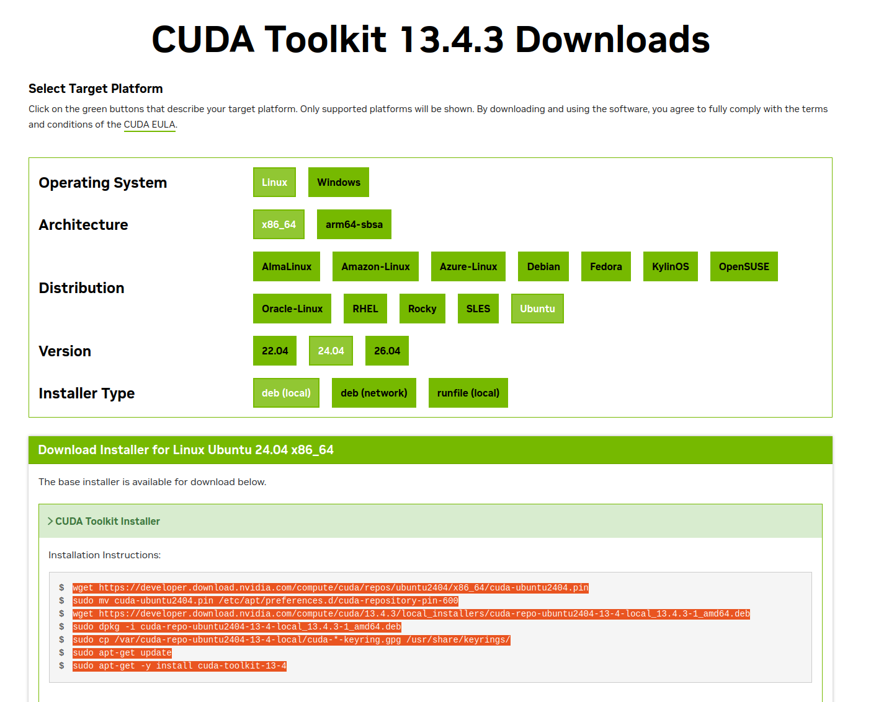
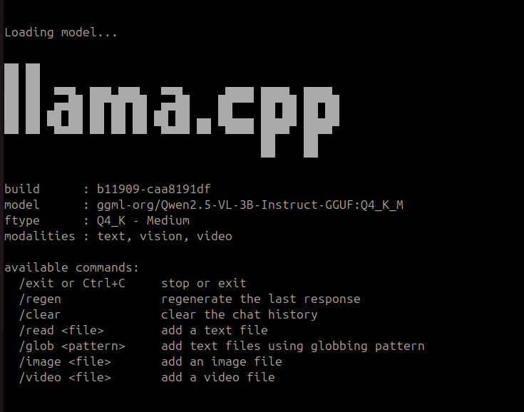
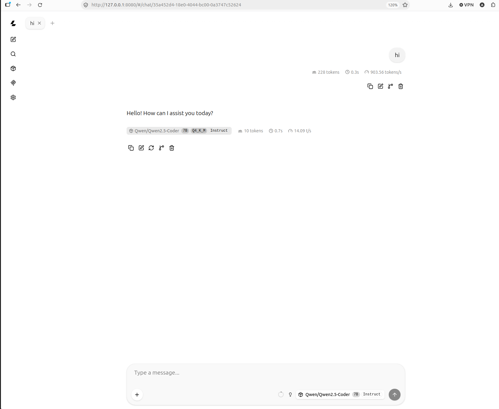
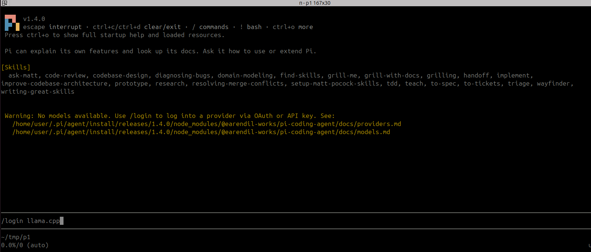
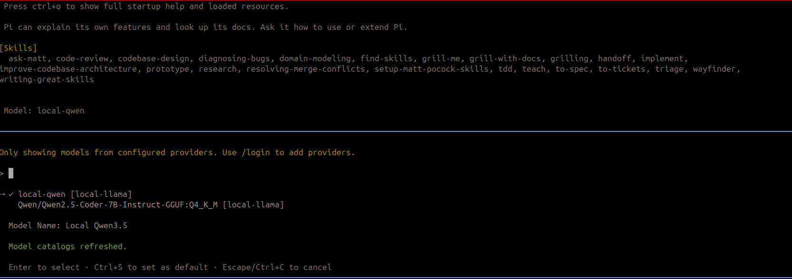

llama.cpp is a lightweight C/C++ runtime for running large language models locally. It uses efficient model formats and quantization to make inference practical on CPUs and optionally GPUs, without requiring a cloud service.

## Install 
### CUDA support

#### install latest cuda toolkit

[cude download](https://developer.nvidia.com/cuda-downloads)




### Update path for current nvcc

```bash
# 1. Append the new CUDA 13 paths to the bottom of your ~/.bashrc file
echo 'export PATH=/usr/local/cuda-13/bin:$PATH' >> ~/.bashrc
echo 'export LD_LIBRARY_PATH=/usr/local/cuda-13/lib64:$LD_LIBRARY_PATH' >> ~/.bashrc

# 2. Apply the changes immediately to your current terminal session
source ~/.bashrc

# 3. Verify that the system is now pointing to the correct version
nvcc --version

```

---

### Build llma.cpp

```bash
# 1. Completely delete the broken build cache directory
rm -rf build/

# 2. Configure CMake by explicitly pointing to the CUDA 13 nvcc compiler
cmake -B build -DGGML_CUDA=ON -DCMAKE_CUDA_COMPILER=/usr/local/cuda-13/bin/nvcc

# 3. Build llama.cpp
cmake --build build -j

```


---

### Models

Download GGUF models from [ggml-org on Hugging Face](https://huggingface.co/ggml-org), such as [Qwen2.5-VL-3B-Instruct-GGUF](https://huggingface.co/ggml-org/Qwen2.5-VL-3B-Instruct-GGUF/tree/main). The [llama.cpp model guide](https://github.com/ggml-org/llama.cpp/blob/master/docs/models.md) explains downloading models with `-hf`.

!!! info path
    The models locate in `~/.cache/huggingface/hub`
    

Model files usually use the `.gguf` format, which packages the model weights, tokenizer, and metadata for llama.cpp. A typical name is `Qwen2.5-VL-3B-Instruct-Q4_K_M.gguf`: model family, model size, tuned variant, then quantization.

`Q4_K_M` is a 4-bit K-quant model in the medium-quality variant. It is a practical balance of file size, memory use, speed, and output quality; lower-bit variants use less memory, while higher-bit variants generally preserve more quality.

|Example filename|Quantization|Typical trade-off|
|---|---|---|
|`Model-Q2_K.gguf`|2-bit K-quant|Smallest memory use, with a noticeable quality loss|
|`Model-Q4_K_M.gguf`|4-bit K-quant, medium variant|A common balance of quality and memory use|
|`Model-Q6_K.gguf`|6-bit K-quant|More memory use, with quality closer to the original model|
|`Model-Q8_0.gguf`|8-bit quantization|Largest of these examples, with the least quality loss|

|Part|Meaning|
| -- | ---   |
|Q4  | 4-bit quantization (weights are stored using ~4 bits per parameter) |
|K | Uses K-quant method (a more advanced quantization technique from llama.cpp) |
|M | Medium quality variant of the K-quant |

---

### CLI tutorial

`-hf` downloads the selected GGUF file on first use and reuses its local cache afterwards.

1. Download and chat with a model:

```bash
./build/bin/llama-cli -hf ggml-org/Qwen2.5-VL-3B-Instruct-GGUF:Q4_K_M  -c 16384
```




!!! tip Context
    In LLMs, Context (often called the context window) is the short-term memory of the AI. It is the total amount of text—both your prompt and the AI's response—that the model can read and remember at any given single moment.
    
    Think of it like a desk surface:
    - A **small context** means a small desk. The AI can  only look at a few pages of text at once. If your conversation gets too long, it forgets the beginning.
    - A **large context** means a massive desk. The AI can read entire books, long code files, or multiple high-resolution images all at the exact same time without forgetting anything.
    

!!! tip Context and return text for code
    - To prevent Out of Memory crashes on your RTX 5070: Keep -c around 4096 or **16384**.
    - To prevent the AI from cutting off mid-code: Always set **-n -1** so it has the freedom to write the full script without a strict limit.

---

### Models to download

### Qwen

```
[Family/Version] - [Capability] - [Size] - [Type] - [File Format] : [Quantization]
     Qwen2.5     -     VL       -  3B   - Instruct -   GGUF      :   Q4_K_M
```

- **Qwen2.5 — family and version:** Alibaba's Qwen model family, version 2.5.
- **VL — capability:** Vision-Language, meaning the model supports text and images. Other variants include `Coder` for programming and `Math` for mathematics.
- **3B — parameter count:** Approximately 3 billion parameters. Larger models generally need more memory; size alone does not determine quality or speed.
- **Instruct — training type:** Fine-tuned to follow instructions and respond as an assistant. A `Base` model primarily continues text and has not received this instruction tuning.
- **GGUF — file format:** Stores model weights and metadata for runtimes such as llama.cpp.
- **Q4_K_M — quantization:** A mostly 4-bit K-quant scheme with a medium variant, balancing memory use and model quality.

Here, `:Q4_K_M` selects a quantization in a llama.cpp Hugging Face download identifier. An actual filename may look like `Qwen2.5-VL-3B-Instruct-Q4_K_M.gguf`.

!!! info "Common Qwen capabilities and uses"

    | Capability tag | Typical use |
    | --- | --- |
    | **No specialist tag** | General writing, summarization, translation, and questions. Check the model card for supported inputs. |
    | **Coder** | Generate, explain, debug, and complete code. |
    | **Math** | Solve mathematical problems and follow mathematical reasoning. |
    | **VL** (Vision-Language) | Understand images, read text in screenshots or documents, and interpret charts. Some versions also support video. |
    | **Audio** | Understand audio, transcribe speech, and answer questions about sounds. |
    | **Omni** | Combine text, image, audio, and video understanding, with text and speech responses. |

    Tags vary by generation, and runtime support depends on the specific model. `Instruct` describes instruction tuning, while `GGUF` and `Q4_K_M` describe packaging and quantization.

    Sources: [Qwen model concepts](https://qwen.readthedocs.io/en/stable/getting_started/concepts.html), [Qwen2.5-Omni technical report](https://arxiv.org/abs/2503.20215).

---

### Server
2. Start a local OpenAI-compatible API server. It listens on `http://127.0.0.1:9931` by default:

```bash
./build/bin/llama-server \
  -hf ggml-org/Qwen2.5-VL-3B-Instruct-GGUF:Q4_K_M
```

Add `-ngl 99` to either command to offload as many layers as possible to a compatible GPU.

3. In another terminal, send a chat request:

```bash
curl http://127.0.0.1:9931/v1/chat/completions \
  -H 'Content-Type: application/json' \
  -d '{"model":"local","messages":[{"role":"user","content":"Hello"}]}'
```

---


### Vision example

```
./build/bin/llama-mtmd-cli \
  -hf ggml-org/Qwen2.5-VL-3B-Instruct-GGUF:Q4_K_M \
  --image "$HOME/Downloads/sim_godot.png" \
  -p "Describe the image in brief" \
  -n 128

```

---

### Coding model example

[Qwen2.5-Coder-7B-Instruct-GGUF](https://huggingface.co/Qwen/Qwen2.5-Coder-7B-Instruct-GGUF) is a code-focused model. The `Q4_K_M` variant is about 4.7 GB and is a practical choice for local coding assistance.

```bash title="download the model"
./llama-cli -hf Qwen/Qwen2.5-Coder-7B-Instruct-GGUF:Q4_K_M
```

```bash
./llama-server \
  -hf Qwen/Qwen2.5-Coder-7B-Instruct-GGUF:Q4_K_M \
  -ngl 99
```

The server exposes an OpenAI-compatible API at `http://127.0.0.1:9931/v1`, which can be used by OpenCode. In another terminal, send a coding prompt:

```bash
curl http://127.0.0.1:9931/v1/chat/completions \
  -H 'Content-Type: application/json' \
  -d '{"model":"local","messages":[{"role":"user","content":"Write hello world Python function."}]}'
```


```bash title="pipe to jq for content only"
curl -s http://127.0.0.1:9931/v1/chat/completions \
  -H "Content-Type: application/json" \
  -d '{
    "messages": [
      {"role": "user", "content": "Write a Python hello-world program."}
    ],
    "temperature": 0.2,
    "max_tokens": 500
  }' | jq -r '.choices[0].message.content'
```


```bash title="bench check"
./llama-bench   -hf Qwen/Qwen2.5-Coder-7B-Instruct-GGUF:Q4_K_M   -ngl 
99   -p 512   -n 128   -r 3

##
ggml_cuda_init: found 1 CUDA devices (Total VRAM: 7705 MiB):
  Device 0: NVIDIA GeForce RTX 5070 Laptop GPU, compute capability 12.0, VMM: yes, VRAM: 7705 MiB
| model                          |       size |     params | backend    | ngl |            test |                  t/s |
| ------------------------------ | ---------: | ---------: | ---------- | --: | --------------: | -------------------: |
| qwen2 7B Q4_K - Medium         |   4.36 GiB |     7.62 B | CUDA       |  99 |           pp512 |       679.68 ± 74.75 |
| qwen2 7B Q4_K - Medium         |   4.36 GiB |     7.62 B | CUDA       |  99 |           tg128 |         11.72 ± 0.04 |


```

---

## Pi


```
./llama-server \
  -hf unsloth/Qwen3.5-4B-GGUF:Q4_K_M \
  --alias local-qwen \
  --jinja \
  --chat-template-kwargs '{"enable_thinking":false}' \
  --no-skip-chat-parsing \
  --no-mmproj \
  -ngl 99 \
  -np 1 \
  -c 16384 \
  --host 127.0.0.1 \
  --port 8080
```


| Argument | Meaning | Why use it here |
|---|---|---|
| `-hf unsloth/Qwen3.5-4B-GGUF:Q4_K_M` | Downloads and loads the `Q4_K_M` quantization from the named Hugging Face repository. | Avoids manually downloading a GGUF file. |
| `--alias local-qwen` | Publishes the model under this name in the server's OpenAI-compatible API. | Clients can request `local-qwen` instead of the Hugging Face repository name. |
| `--jinja` | Enables the model's Jinja chat template. | Required for the model's chat and structured tool-call format. |
| `--no-skip-chat-parsing` | Parses structured chat output instead of returning it as plain text. | Lets API clients receive parsed assistant and tool-call messages. |
| `--no-mmproj` | Disables automatic loading of a multimodal projector. | This text-only setup does not need image support. |
| `-ngl 99` | Offloads as many model layers as possible to the GPU. | `99` exceeds the model's layer count, so all layers that fit use CUDA. |
| `-np 1` | Creates one parallel request slot. | Keeps VRAM use predictable on an 8 GB GPU. |
| `-c 8192` | Sets the context window to 8,192 tokens. | Fits local agent prompts while keeping the KV cache within VRAM. |
| `--host 127.0.0.1` | Binds the server only to the local machine. | Prevents other devices on the network from accessing the model. |
| `--port 8080` | Selects the HTTP port. | Matches the Pi configuration's `baseUrl`. |

### Server web chat




### Install PI
```bash title="install"
curl -fsSL https://pi.dev/install.sh | sh
```

### Config pi

put `model.json` in folder `~/.pi/agent`

```json title="~/.pi/agent/models.json"
{
  "providers": {
    "local-llama": {
      "baseUrl": "http://127.0.0.1:8080/v1",
      "api": "openai-completions",
      "apiKey": "none",
      "models": [
        {
          "id": "local-qwen",
          "name": "Local Qwen3.5",
          "contextWindow": 16384,
          "maxTokens": 4096
        }
      ]
    }
  }
}
```

### Usgae
```bash title run
pi
```

#### login



#### Set model


!!! warning "qwen 2.5"
    I don't success with qwen 2.5 in agent mode that the model create edit or run files. qwen 3.5 run out of the box
    

---

## OMP (Oh My Pi)

---

## Reference
- [28 llama.cpp Flags You Should Know ](https://youtu.be/eItrjzseZdo)
